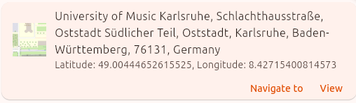

# jsonld2cards

Renders Schema.org Markup data as Cards.
Many Websites, such as News Sites or Music Streaming sites, already include markup.
But it can also be found for example in flight reservation emails.
This package gives a way to quickly visualize these markups.
The package has bespoke support for a variety of markup data types, but also offers a robust fallback handler.

For example a markup like
```json
{
  "@context": "https://schema.org",
  "@type": "Place",
  "geo": {
    "@type": "GeoCoordinates",
    "latitude": "49.00444652615525",
    "longitude": "8.42715400814573"
  },
  "name": "University of Music Karlsruhe, Schlachthausstraße, Oststadt Südlicher Teil, Oststadt, Karlsruhe, Baden-Württemberg, 76131, Germany",
  "image": {
    "contentUrl": "data:image/png;base64,iVBORw0KG...=="
  }
}
```
would be rendered as follows:




## Usage

Below a simple usage example to generate the above card
```dart
import 'dart:convert';

import 'package:jsonld2cards/card_data.dart';
import 'package:jsonld2cards/card_rendering.dart';

var markupSource = '''{
  "@context": "https://schema.org",
  "@type": "Place",
  "geo": {
    "@type": "GeoCoordinates",
    "latitude": "49.00444652615525",
    "longitude": "8.42715400814573"
  },
  "name": "University of Music Karlsruhe, Schlachthausstraße, Oststadt Südlicher Teil, Oststadt, Karlsruhe, Baden-Württemberg, 76131, Germany",
  "image": {
    "contentUrl": "data:image/png;base64,iVBORw0KG...=="
  }
}''';

Map<String, dynamic> markup = jsonDecode(markupSource);
var cardData = CardData(markup);
Widget card = mustRenderCardFromCardData(cardData);
```

An example app with more schema snippets collected from the web can be found in the [example](./example/lib/main.dart) folder.

## Additional Configuration
The `CardData` object has a number of optional parameters, that control for example whether to render
an additional descriptive bar on top of the card. Refer to the API documentation/ docstrings of the
CardData class for more information.

The global variable `globalAppContext` can be used for additional configuration, that is applied to
the entire package. We recommend setting it for example in the main method of the app.

It can be used to set

* A callback function for confirm/ cancel actions
* A callback function to share calendar events
* A url used for image proxying (only relevant if the app is deployed on the web)
* A uri for a view action on a location
* A uri for a "navigate to" view action on a location

Additionally for a LiveLocation card, on press on "refresh", API calls to a OpenStreetMap tile server and
a OpenStreetMap Nominatim server are being made.
The urls can be configured via the `globalAppContext` object.
If not configured, refreshing the map preview and place name will not work.
We are considering changing the behaviour, in such a way, that the LiveLocation sender would send the
corresponding data, to avoid external api calls from the receiver.

More details on the urls/ uris and callbacks can be fund in the API documentation of `AppContext`.
The example app also sets the `globalAppContext`.

## Localization

We are working on localizing this package. To then use the localized version of this package, you will
need to add this package's LocalizationsDelegate to your app.